# HesapKitap

[](https://github.com/AykanYilmz/HesapKitap/actions/workflows/ci.yml)
[](https://codecov.io/gh/AykanYilmz/HesapKitap)

**Banka ekstreni yükle, paranın nereye gittiğini gör.** HesapKitap, hesap ve kredi kartı ekstrelerini (PDF / CSV) okuyup her harcamayı otomatik olarak kategorize eden, aylık özet, bütçe ve abonelik takibi sunan bir kişisel finans uygulamasıdır. Yanlış kategorileri düzelttikçe sistem senin kurallarını öğrenir.

> Canlı demo henüz yayında değil; proje [tek komutla](#production) yayına alınabilecek durumda. Yerelde sahte verilerle dolu bir demo hesabı [şöyle](#demo-hesabı) oluşturulur.

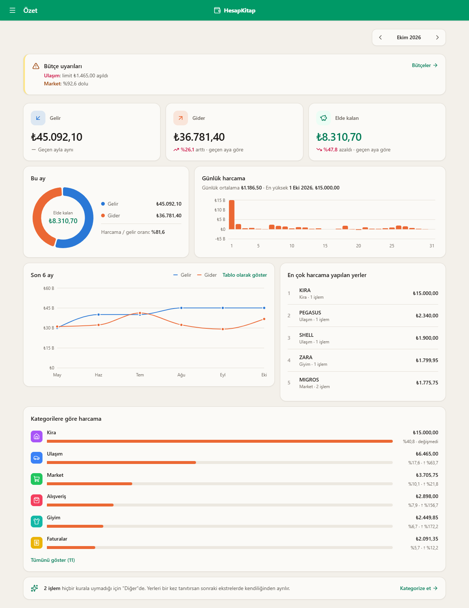

## İçindekiler

- [Özellikler](#özellikler)
- [Ekran görüntüleri](#ekran-görüntüleri)
- [Mimari](#mimari)
- [Teknolojiler ve seçim nedenleri](#teknolojiler-ve-seçim-nedenleri)
- [Kurulum](#kurulum)
- [Testler ve CI](#testler-ve-ci)
- [Güvenlik](#güvenlik)
- [Öğrendiklerim](#öğrendiklerim)
- [Yol haritası](#yol-haritası)

## Özellikler

**Ekstre okuma**
- CSV ve PDF; başlık satırı, sütunlar ve dosya kodlaması (UTF-8 / Windows-1254) otomatik bulunur.
- Türkçe biçimler: `GG.AA.YYYY` tarih, `1.234,56 TL` tutar, ayrı Borç / Alacak sütunları.
- Kredi kartı ekstreleri tanınır ("Son Ödeme Tarihi", "Asgari Ödeme"…): harcama ve ödeme işaretleri buna göre okunur.
- Aynı ekstre ya da çakışan iki ekstre yüklense de işlemler bir kez kaydedilir; aynı gün iki özdeş harcama ise ikisi de kalır.

**Kategorizasyon**
- Türkiye'ye özgü anahtar kelimeler (MIGROS, A101, OPET, NETFLIX…) ve kullanıcının öğrettiği kurallar; kullanıcı kuralı her zaman önce gelir.
- **Kategori Eğitimi:** tanınmayan işlemler işyerine göre gruplanır (`PAYTR/`, taksit notu, şehir adı temizlenir); tek seçimle bütün grup kural olarak öğretilir.
- İadeler harcamayı azaltır, hesaptan kart borcu ödemesi Transfer sayılır (çift sayılmaz).

**Raporlar ve takip**
- Özet: gelir, gider, elde kalan, kategori dağılımı, günlük harcama, 6 aylık trend, en çok harcama yapılan yerler.
- Raporlar (6 / 12 / 24 ay), kategori ısı haritası, takvim görünümü, yazdırılabilir rapor (PDF).
- Ay, istenirse kart **hesap kesim gününe** göre bölünür (ör. 6 → "Ekim" = 7 Eylül – 6 Ekim).
- **Bütçeler:** kategori bazlı aylık limit, %80'de ve aşınca uyarı, ay sonu tahmini.
- **Abonelikler:** her ay tekrar eden ödemeler otomatik bulunur; zam, sonraki ödeme tarihi, durmuş görünenler.
- Excel (işlemler + aylık özet + kategoriler) ve CSV dışa aktarma.

**Hesap**
- Kayıt, giriş, e-posta doğrulama ve değiştirme, şifre değiştirme (diğer oturumları kapatır), hesap silme.
- Açık / koyu tema, mobil uyumlu arayüz.

## Ekran görüntüleri

| Bütçeler | Abonelikler |
|---|---|
| 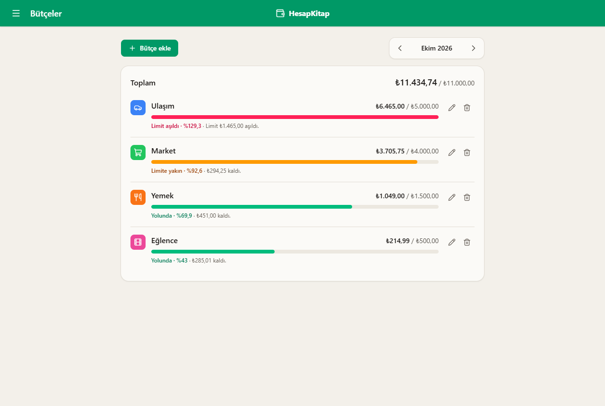 | 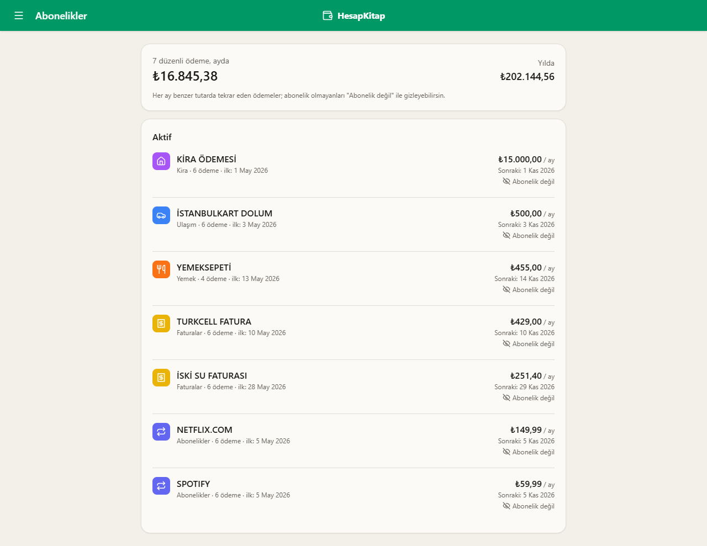 |
| **Kategori Eğitimi** | **İşlemler** |
| 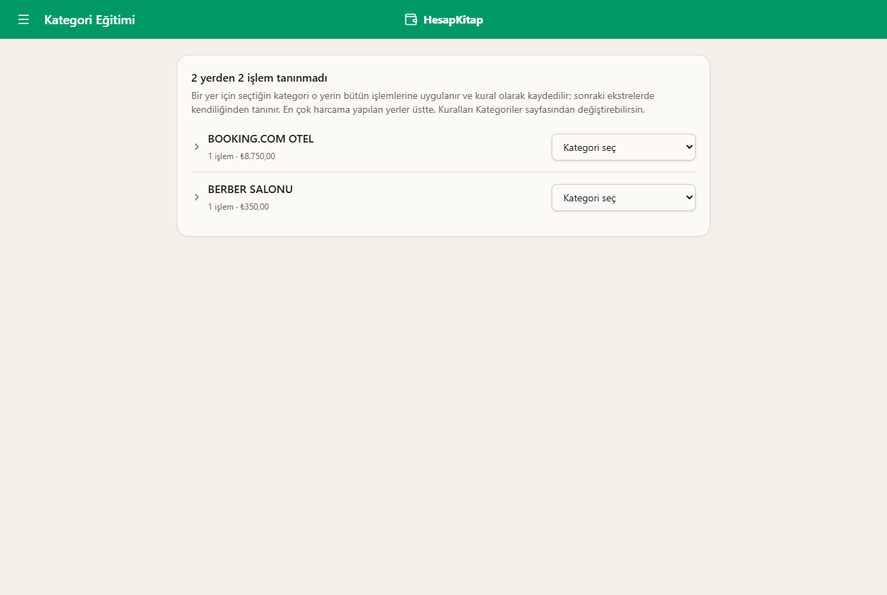 | 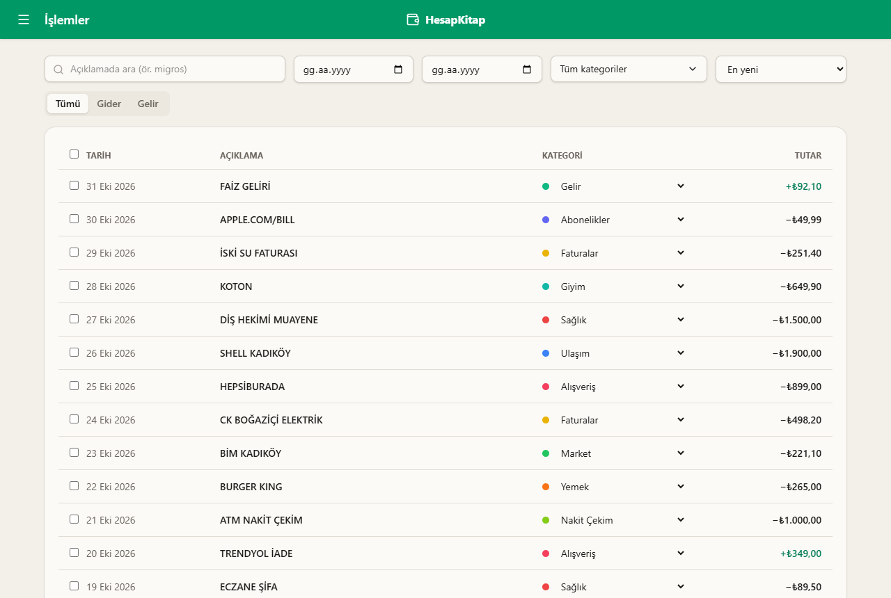 |
| **Raporlar** | **Ekstre yükleme** |
| 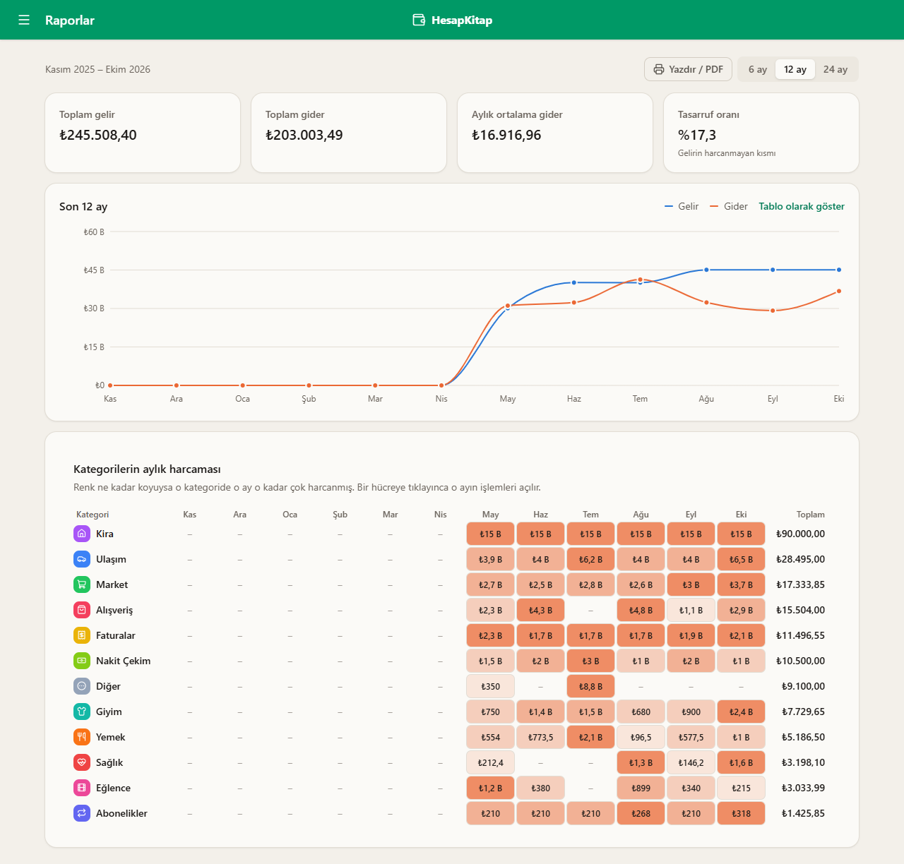 | 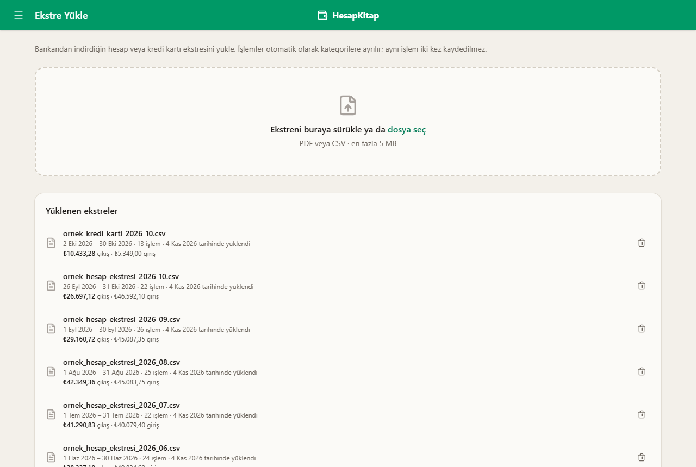 |
| **Koyu tema** | **Menü** |
| 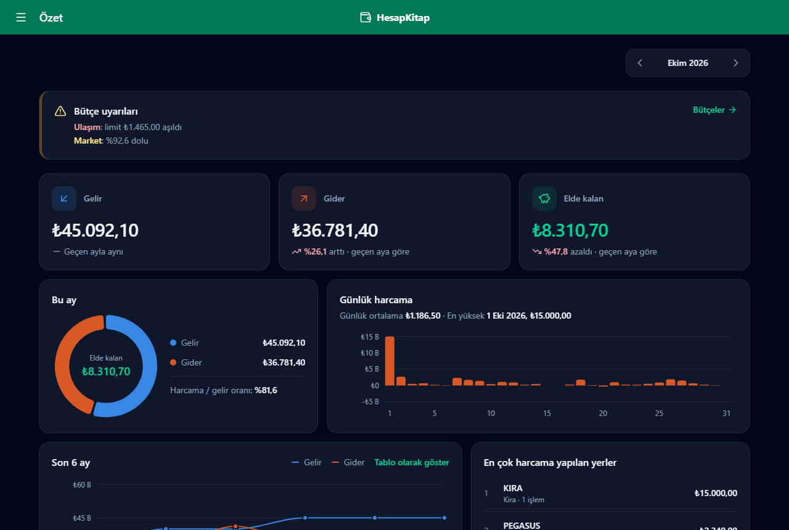 | 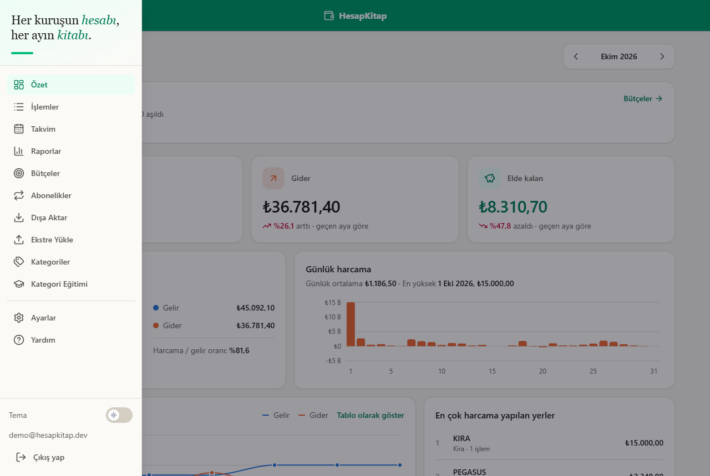 |

<p align="center">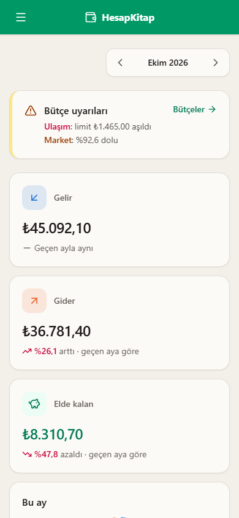</p>

## Mimari

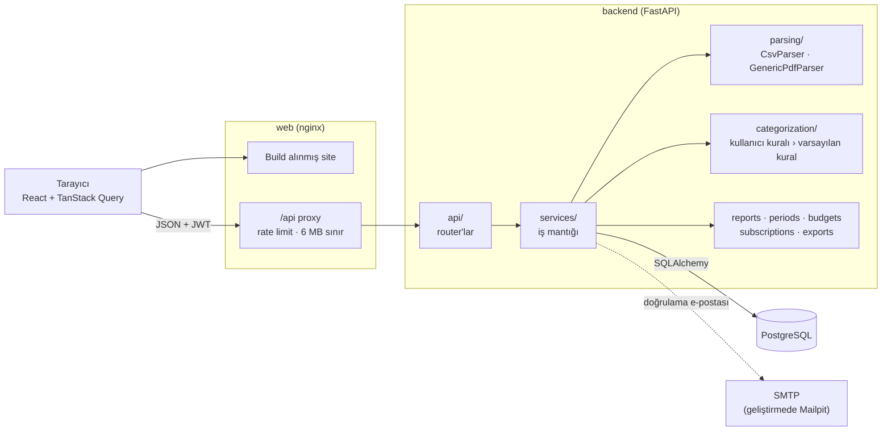

Backend katmanlıdır: **router'lar** yalnızca HTTP ile ilgilenir (doğrulama, hata kodları), **servisler** iş mantığını taşır ve HTTP'den habersizdir, bu yüzden doğrudan test edilebilir. Frontend'in API tipleri backend'in OpenAPI şemasından üretilir (`npm run gen:api`); bir alan değişince TypeScript derlemesi hangi ekranın etkilendiğini gösterir.

### Bir ekstre yüklendiğinde

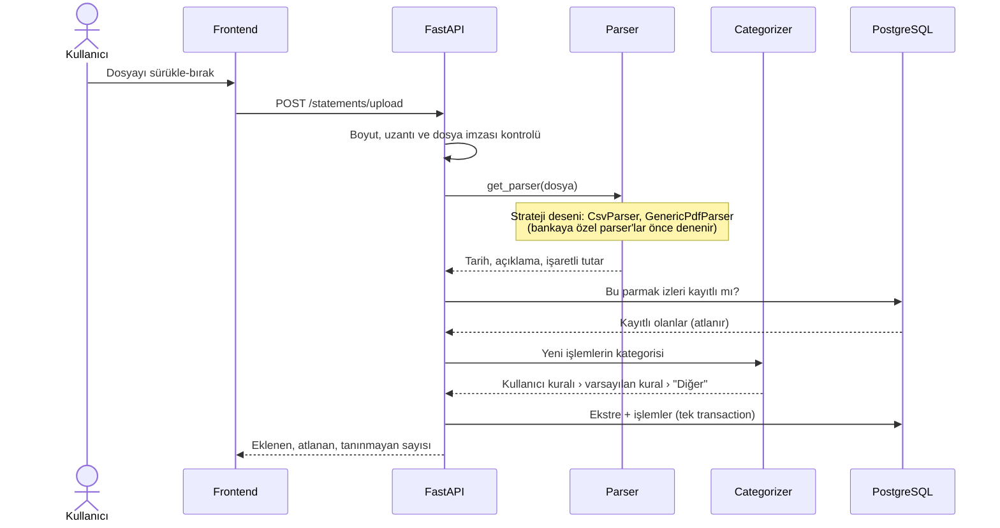

### Veri modeli

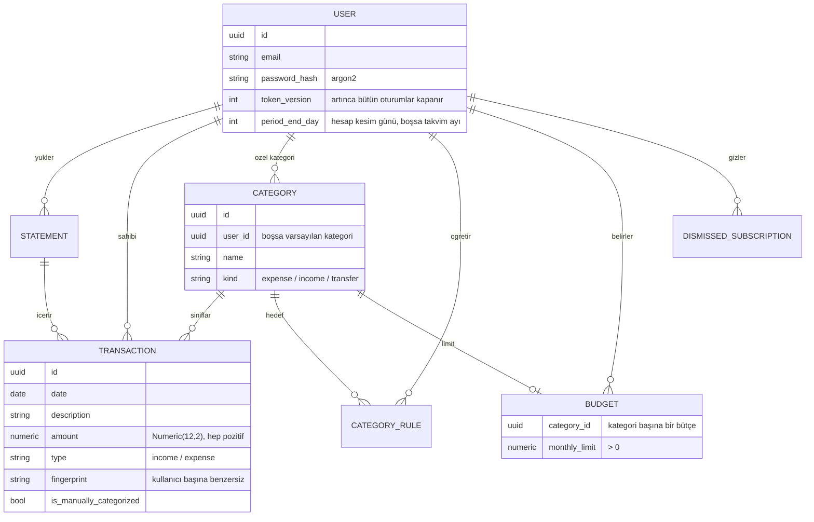

Raporlar kategori **türüne** göre hesaplanır: Transfer hiç sayılmaz, gelir kategorileri net gelirdir, bir harcama kategorisindeki iade o kategorinin harcamasını azaltır. Abonelikler tabloda tutulmaz, her istekte işlemlerden hesaplanır; böylece bir işlem silinince ya da düzeltilince hiçbir şey eskimez.

## Teknolojiler ve seçim nedenleri

| | Seçim | Neden |
|---|---|---|
| API | **FastAPI**, Pydantic v2 | Tip ipuçlarından doğrulama ve OpenAPI dokümantasyonu; frontend tipleri bu şemadan üretilir. |
| Veritabanı | **PostgreSQL 17**, SQLAlchemy 2.0, Alembic | Para için `Numeric`, `NULLS NOT DISTINCT` gibi kısıtlar; migration'lar CI'da modellerle karşılaştırılır (`alembic check`). |
| Ekstre okuma | **pdfplumber**, stdlib `csv` | pdfplumber hem çizgili tabloları hem düz metni okur; CSV için pandas gereksiz ağır. |
| Kimlik | **pwdlib** (argon2), PyJWT | Argon2 güncel öneri; access (15 dk) + refresh (7 gün) token, `token_version` ile iptal. |
| Excel | **openpyxl** | `.xlsx` yazmanın standart, küçük kütüphanesi. |
| Frontend | **React 19**, TypeScript, Vite | |
| Sunucu verisi | **TanStack Query** | Önbellek ve "şu değişince şunları yenile" mantığı tek yerde (sorgu anahtarları). |
| Stil | **Tailwind CSS v4** | Renkler semantik token (`bg-surface`, `text-fg-muted`); koyu tema tek sınıfla. |
| Grafik | **Recharts** | Renkler renk körlüğüne göre seçildi; pasta yerine sıralı çubuklar (karşılaştırması daha kolay). |
| Altyapı | Docker (multi-stage), **nginx**, GitHub Actions, Codecov | |

Bilinçli olarak eklenmeyenler: **pandas** (CSV için gereksiz), **scikit-learn** (ölçüldü, yeterli bulunmadı; bkz. [Öğrendiklerim](#öğrendiklerim)).

## Kurulum

Gereksinim: [Docker Desktop](https://www.docker.com/products/docker-desktop/)

```bash
git clone https://github.com/AykanYilmz/HesapKitap.git
cd HesapKitap
cp .env.example .env
# .env içindeki JWT_SECRET'ı doldurun:
# python -c "import secrets; print(secrets.token_hex(32))"
docker compose up --build
```

| Servis | Adres |
|---|---|
| Uygulama | http://localhost:5173 |
| API dokümantasyonu (Swagger) | http://localhost:8000/docs |
| Mailpit (geliştirmede gönderilen e-postalar) | http://localhost:8025 |
| PostgreSQL | `localhost:5432` |

### Demo hesabı

Sahte ekstrelerle (Mayıs–Ekim), bütçelerle dolu bir hesap oluşturur; tekrar çalıştırınca sıfırlar:

```bash
docker compose exec backend python -m app.demo   # demo@hesapkitap.dev / demo12345
```

`sample_data/` klasöründeki sahte ekstreleri arayüzden de yükleyebilirsin.

### Docker olmadan geliştirme

```bash
# Backend (veritabanı için: docker compose up -d db)
cd backend
python -m venv .venv && source .venv/bin/activate   # Windows: .venv\Scripts\activate
pip install -e ".[dev]"
alembic upgrade head
uvicorn app.main:app --reload

# Frontend
cd frontend
npm install
npm run dev
```

Her commit öncesinde lint ve format kontrolleri için: `pre-commit install`.

### Production

`docker-compose.prod.yml` uygulamayı production imajlarıyla çalıştırır:

- **web:** nginx build alınmış siteyi sunar, `/api`'yi backend'e yönlendirir (aynı adres, CORS gerekmez), 6 MB'tan büyük yüklemeleri reddeder, giriş / kayıt / şifre / e-posta isteklerine rate limit uygular, güvenlik başlıklarını ekler.
- **backend:** yalnızca uygulama ve çalışma zamanı bağımlılıkları, root olmayan kullanıcı; açılışta migration'ları uygular.
- **db:** PostgreSQL, dışarıya kapalı.

```bash
cp .env.production.example .env.production   # bütün değerleri doldurun
docker compose -f docker-compose.prod.yml --env-file .env.production up -d --build
docker compose -f docker-compose.prod.yml --env-file .env.production exec backend python -m app.demo
```

Site `WEB_PORT` (varsayılan 80) üzerinden düz http yayınlanır; https önündeki platform ya da Caddy gibi bir proxy tarafından sağlanmalıdır. API dokümantasyonu `/api/docs` adresindedir.

## Testler ve CI

```bash
cd backend && pytest --cov     # 400+ test, gerçek PostgreSQL'e karşı; kapsam %80'in altındaysa başarısız
cd frontend && npm test        # Vitest + Testing Library
```

- Backend testleri ayrı bir test veritabanında, her test kendi transaction'ı içinde çalışır ve sonunda geri alınır: testler birbirini etkilemez, yine de gerçek SQL çalışır.
- E-posta gönderimi testlerde sahte bir göndericiyle yakalanır.
- Ekstre parser'ları `sample_data/` altındaki sahte dosyalarla ve test içinde üretilen PDF'lerle test edilir.

Her push ve pull request'te [GitHub Actions](.github/workflows/ci.yml): ruff, black, `alembic check`, backend testleri ve kapsam ([Codecov](https://codecov.io/gh/AykanYilmz/HesapKitap)), ESLint, Prettier, Vitest, frontend build ve iki production Docker imajının build'i.

## Güvenlik

- **Gerçek banka verisi repoda yok.** `sample_data/` altındaki her şey sahtedir; `.gitignore` bu klasör dışındaki PDF, CSV ve Excel dosyalarını engeller. Yüklenen dosyalar diske kaydedilmez, yalnızca içinden okunan işlemler saklanır.
- Şifreler argon2 ile hash'lenir. Şifre değişince bütün eski token'lar geçersiz olur.
- Dosya yüklemede boyut, uzantı ve gerçek dosya imzası (`%PDF-`) kontrol edilir; 50 sayfadan uzun PDF'ler (küçük ama binlerce sayfalık dosyalar) reddedilir.
- Dışa aktarılan dosyalarda açıklamalar düz metin olarak yazılır; `=HYPERLINK(...)` gibi bir satır Excel'de formül olarak çalışmaz (CSV/formül enjeksiyonu).
- SQL yalnızca SQLAlchemy ile, parametreli; arama kutusundaki `%` ve `_` kaçışlanır.
- nginx giriş ve e-posta uç noktalarına rate limit uygular. `ENVIRONMENT=production` iken uygulama geliştirme veritabanı şifresiyle ya da `https` olmayan bir site adresiyle açılmayı reddeder.

## Öğrendiklerim

- **Banka ekstresi bir standart değil.** Her banka başlığı farklı yere koyuyor, kimi Windows-1254 kodlamasıyla kaydediyor. Kredi kartı ekstresinde işaretler hesap ekstresinin tersi: harcama işaretsiz, ödeme `+` ile yazılıyor. Bir ekstre PDF'inde sayfanın birebir kopyası vardı ve her işlem iki kez okunuyordu. Parser'ı strateji deseniyle yazmak, bu sürprizlerin her birini diğerlerini bozmadan çözmeyi sağladı.
- **Mükerrer kontrolü sanıldığı kadar basit değil.** "Aynı tarih, aynı açıklama, aynı tutar" bir işlemi tanımlamıyor: aynı gün iki kahve alınabilir. Parmak izine o gün içindeki sıra numarası eklendi; çakışan iki ekstre birlikte yüklenince de doğru çalışıyor.
- **Para için float kullanılmaz.** Veritabanında `Numeric(12,2)`, Python'da `Decimal`, JSON'da string. Toplamlar kuruşu kuruşuna doğru çıkıyor; bunu gerçek bir kart ekstresinin kendi özet satırıyla karşılaştırarak doğruladım.
- **"Ay" bile tanım ister.** Kart kullanan biri için Ekim, 7 Eylül – 6 Ekim olabilir. Dönem hesabını tek bir modülde toplamak sayesinde bütün raporlar, bütçeler ve dışa aktarma aynı sınırları kullanıyor; takvim ise bilerek takvim ayı kaldı.
- **Özellik eklemeden önce ölçmek.** Planda TF-IDF + Logistic Regression ile kategori tahmini vardı. "Bir işyerini dışarıda bırak" testiyle denedim: model hiç görmediği işyerlerinde %18, en iyi ayarla %36 doğruydu. İşyeri adının harflerinden "BOOKING.COM"un seyahat olduğu çıkarılamıyor. Üçte ikisi yanlış öneriler sunan bir özellik ve 100 MB'lık bir bağımlılık yerine kural tabanlı sistemi "Kategori Eğitimi" sayfasıyla güçlendirdim.
- **Erişilebilirlik ayarları gerçek.** Sayfa animasyonları bir ara çalışmıyor gibiydi; sebep Windows'ta kapalı olan "animasyon efektleri" ayarıydı ve tarayıcı bunu `prefers-reduced-motion` olarak siteye bildiriyordu. Grafik renklerini renk körlüğü simülasyonuyla seçtim; önemli sayılar grafiklerin yanında metin olarak da yazıyor, trend grafiğinin bir tablo görünümü var.
- **Güvenlik ayrıntıda.** Excel'e yazılan bir açıklama formül olarak çalışabilir; nginx bir backend yeniden başladığında eski IP'ye gitmeye devam edebilir; geliştirme ayarıyla canlıya çıkmak kolaydır. Bunların her biri bir test ya da açılışta bir kontrol olarak koda girdi.

## Yol haritası

- [x] Faz 0 — Kurulum (Docker, FastAPI, React, lint ve pre-commit)
- [x] Faz 1 — Kimlik doğrulama (JWT access + refresh token, e-posta doğrulama)
- [x] Faz 2 — Ekstre yükleme ve ayrıştırma (CSV + PDF, kredi kartı, mükerrer kontrolü)
- [x] Faz 3 — Kategorizasyon (anahtar kelime, kullanıcı kuralları, Kategori Eğitimi)
- [x] Faz 4 — Raporlar (aylık özet, trend, en çok harcama yapılan yerler, kesim günü)
- [x] Faz 5 — Frontend (özet, işlemler, takvim, raporlar, kategoriler, ayarlar; açık/koyu tema)
- [x] Faz 6 — CI, test kapsamı, production imajları (deploy henüz yapılmadı)
- [x] Faz 7 — Bütçeler, abonelik tespiti, dışa aktarma, ekstre toplamları
- [x] Faz 8 — Dokümantasyon ve portfolyo cilası
- [ ] Canlı demo
- [ ] Başka bankaların gerçek ekstreleriyle deneme, gerekirse bankaya özel parser'lar
